# GitDiagram architecture — @konitif/nodal

This architecture view was generated from the public repository by [GitDiagram](https://gitdiagram.com/lemouf/konitif-nodal) on 2026-09-20 18:19:50 UTC.

It is a documentation projection of the repository tree, README, and source files sampled by GitDiagram. It does not replace the authored contracts in [catalog.json](catalog.json) and [diagrams.json](diagrams.json), nor does it establish runtime authority.

The Mermaid source keeps GitDiagram's groups, nodes, relationships, and source links. GitDiagram's forced color classes and HTML line breaks are omitted so the diagram remains readable in local previews and dark themes.

- Public repository: [konitif-nodal](https://github.com/LeMouf/konitif-nodal)
- Interactive diagram: [Open in GitDiagram](https://gitdiagram.com/lemouf/konitif-nodal)

## Architecture diagram

```mermaid
flowchart TD

subgraph group_graph["Graph Authoring"]
  node_graphdoc["Graph Document — [model.ts]"]
  node_graphops["Graph Operations — [graph.ts]"]
  node_editcommands["Edit Commands — [commands.ts]"]
  node_validation["Graph Validation — [validation.ts]"]
  node_serializer["JSON Serializer — [serializer.ts]"]
end

subgraph group_runtime["Execution Runtime"]
  node_execution["Graph Executor — [executeGraph.ts]"]
  node_scalar["Math Executors"]
  node_results["Execution Results — [model.ts]"]
end

subgraph group_projection["Projection Mechanics"]
  node_projection["Viewport Projection"]
  node_coordinates["Coordinate Model"]
  node_interactions["Interaction Models"]
  node_portstate["Port State Model"]
end

subgraph group_composition["Composition Integration"]
  node_compositionadapter["Workflow Adapter"]
  node_compositionpreview["Runtime Preview"]
end

subgraph group_registries["Scoped Registries"]
  node_dialectregistry["Dialect Registry — [registry.ts]"]
  node_mathdialect["Math Dialect — [math.ts]"]
  node_presentationregistry["Presentation Registry — [presentation.ts]"]
end

node_host(("Host Application"))
node_api["Public API — [index.ts]"]
node_compositionpackage["Composition Workflows"]
node_toolmodule["Tool Module — [toolModule.ts]"]

node_host -->|"uses API"| node_api
node_editcommands -->|"edits graph"| node_graphdoc
node_editcommands -->|"clones nodes"| node_graphops
node_editcommands -->|"validates edges"| node_validation
node_serializer -->|"serializes graph"| node_graphdoc
node_dialectregistry -->|"resolves dialect"| node_mathdialect
node_execution -->|"validates graph"| node_validation
node_execution -->|"clones graph"| node_graphops
node_execution -->|"produces results"| node_results
node_execution -.->|"runs executors"| node_scalar
node_projection -->|"uses coordinates"| node_coordinates
node_portstate -->|"checks compatibility"| node_interactions
node_compositionadapter -->|"converts workflow"| node_compositionpackage
node_compositionpreview -->|"reads composition"| node_compositionpackage
node_compositionpreview -->|"executes scalars"| node_scalar
node_compositionpreview -->|"compares outputs"| node_results
node_host -->|"activates dialects"| node_dialectregistry
node_host -->|"registers presentation"| node_presentationregistry
node_host -.->|"adapts graph"| node_compositionadapter
node_host -->|"declares tool"| node_toolmodule

click node_api "https://github.com/lemouf/konitif-nodal/blob/main/src/index.ts"
click node_graphdoc "https://github.com/lemouf/konitif-nodal/blob/main/src/types/model.ts"
click node_graphops "https://github.com/lemouf/konitif-nodal/blob/main/src/core/graph.ts"
click node_editcommands "https://github.com/lemouf/konitif-nodal/blob/main/src/core/commands.ts"
click node_validation "https://github.com/lemouf/konitif-nodal/blob/main/src/core/validation.ts"
click node_serializer "https://github.com/lemouf/konitif-nodal/blob/main/src/core/serializer.ts"
click node_dialectregistry "https://github.com/lemouf/konitif-nodal/blob/main/src/dialects/registry.ts"
click node_mathdialect "https://github.com/lemouf/konitif-nodal/blob/main/src/dialects/math.ts"
click node_presentationregistry "https://github.com/lemouf/konitif-nodal/blob/main/src/dialects/presentation.ts"
click node_execution "https://github.com/lemouf/konitif-nodal/blob/main/src/runtime/executeGraph.ts"
click node_scalar "https://github.com/lemouf/konitif-nodal/blob/main/src/runtime/scalarMathExecutors.ts"
click node_results "https://github.com/lemouf/konitif-nodal/blob/main/src/types/model.ts"
click node_projection "https://github.com/lemouf/konitif-nodal/blob/main/src/projection/nodalProjectionModel.ts"
click node_coordinates "https://github.com/lemouf/konitif-nodal/blob/main/src/projection/nodalCoordinateModel.ts"
click node_interactions "https://github.com/lemouf/konitif-nodal/blob/main/src/projection/nodalInteractionModel.ts"
click node_portstate "https://github.com/lemouf/konitif-nodal/blob/main/src/projection/nodalPortStateModel.ts"
click node_compositionadapter "https://github.com/lemouf/konitif-nodal/blob/main/src/composition/adapters/nodalGraphAdapter.ts"
click node_compositionpreview "https://github.com/lemouf/konitif-nodal/blob/main/src/composition/runtimeScalarPreview.ts"
click node_toolmodule "https://github.com/lemouf/konitif-nodal/blob/main/src/toolModule.ts"

```

## Generated analysis

@konitif/nodal is a portable graph-mechanics library. A host application creates or edits a Nodal graph, validates and serializes it, resolves scoped dialect contributions, then executes the graph to obtain deterministic outputs and node state. Hosts may also project the graph into headless coordinate and interaction models, register presentation contributions, or adapt graphs to Composition workflows. The sampled runtime confirms execution, registry, projection, and adapter calls; some exported capabilities are represented without inferred internal wiring.
